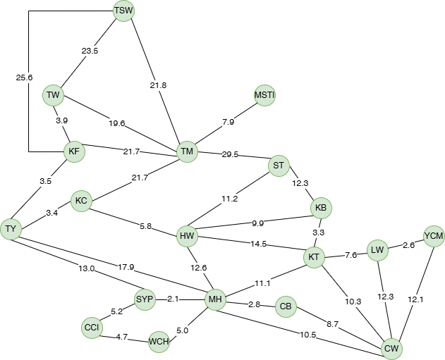

# Part A1: Route Finding

## 1. Problem and algorithm selection

The task is to find an optimal route from CW to TSW in Figure 1 of the ITP4524 assignment. Edge weights are distances in kilometres. Therefore, an optimal route minimizes total distance, rather than the number of edges travelled.

I selected Uniform Cost Search (UCS) as the uninformed algorithm and A* as the informed algorithm. Both are covered in the course's Primer on Artificial Intelligence. UCS selects a node using its accumulated distance from the start, g(n). A* uses f(n) = g(n) + h(n), where h(n) is the assignment's estimate of the remaining distance to TSW. Only A* uses h(n) for search decisions.

BFS is not selected because unequal edge distances mean a route with fewer edges need not have a smaller total distance. Greedy best-first search is also not selected because using only h(n) does not generally guarantee an optimal route.

## 2. Graph representation and assumptions

Figure 1 contains 19 nodes and 33 edges. As no arrows are shown, the edges are treated as undirected: each distance is stored in both directions in an adjacency dictionary. A crossing without a labelled node is not treated as a junction.



The outer line on the left connects TSW and KF, with distance 25.6 km. The separate TY–SYP and TY–MH edges have distances 13.0 and 17.9 km. The HW–KB label was checked in an enlarged copy of the original image and reads 9.9 km.

All graph distances are positive. Internally, costs are integers in units of 0.1 km; for example, 10.5 km is stored as 105. This preserves the supplied distances while avoiding floating-point comparison errors. Output values are converted back to kilometres.

## 3. Implementation

### 3.1 Uniform Cost Search

UCS begins with CW at cost zero in a priority queue. It repeatedly removes the entry with the smallest g value. For each adjacent node, it calculates a candidate distance. If this improves the best known distance, it updates the distance and parent, then inserts the improved entry into the queue. The goal is accepted when it is removed as the current lowest-cost valid entry.

The UCS function does not accept or read a heuristic table. Ties in distance are resolved alphabetically by node name. Because all edge costs are nonnegative, a node removed with its current minimum cost has an optimal distance from CW.

### 3.2 A* search

A* uses the same best-distance and parent ideas, but orders entries by f = g + h. Ties in f are resolved by smaller g and then alphabetically by node name. The supplied h values are used without modification. The algorithm stops when TSW is removed as the current minimum-priority valid entry.

Both algorithms can leave an older entry in the heap after finding a better path to the same node. Such stale entries are discarded when removed. A* does not permanently close an expanded node: if a lower g is later found, that node is inserted again and may be expanded again. This matters for the supplied heuristic, as discussed below.

Parents are followed backwards from TSW to reconstruct the route. The implementation uses dictionaries, lists, functions and loops. Python's standard-library heapq provides the priority queue; no ready-made shortest-path solver is called.

## 4. Heuristic checks and optimality

An admissible heuristic satisfies h(n) <= d*(n, TSW), where d* is the actual shortest remaining distance. The program checks this against exact UCS distances for all 19 nodes. Independent backtracking tests also verify the distances. Every supplied h value is admissible, and h(TSW) = 0.

Consistency is the stronger condition h(u) <= c(u,v) + h(v) for each directed edge check. The supplied table violates this condition in six directions:

| Edge direction | h(u) | c(u,v) + h(v) | Consistent? |
| --- | ---: | ---: | --- |
| TY to KF | 29.0 | 3.5 + 25.0 = 28.5 | No |
| HW to KC | 38.0 | 5.8 + 32.0 = 37.8 | No |
| MSTI to TM | 29.0 | 7.9 + 21.0 = 28.9 | No |
| KB to HW | 48.0 | 9.9 + 38.0 = 47.9 | No |
| LW to KT | 59.0 | 7.6 + 51.0 = 58.6 | No |
| CB to MH | 47.0 | 2.8 + 44.0 = 46.8 | No |

Consequently, it would be unsafe in general to permanently reject every later improvement to an expanded node. This implementation allows reopening. With nonnegative edges, an admissible heuristic, h(goal) = 0 and this best-cost update policy, A* retains optimality. The finite positive-weight graph also allows both algorithms to terminate. No actual reopening occurs in this particular CW-to-TSW run, but a separate test verifies that the implementation handles a case requiring it.

## 5. Results

Both algorithms return the same route:

```text
CW -> MH -> SYP -> TY -> KF -> TSW
```

| Route segment | Distance (km) |
| --- | ---: |
| CW to MH | 10.5 |
| MH to SYP | 2.1 |
| SYP to TY | 13.0 |
| TY to KF | 3.5 |
| KF to TSW | 25.6 |
| Total | 54.7 |

Independent enumeration of simple paths with backtracking confirms that 54.7 km is the minimum distance. The tests additionally compare both algorithms against this independent reference from every node to TSW.

### 5.1 Search effort

| Measurement | UCS | A* |
| --- | ---: | ---: |
| Route distance (km) | 54.7 | 54.7 |
| Valid queue removals, including goal | 18 | 6 |
| Node expansions, excluding goal | 17 | 5 |
| Adjacent-edge checks | 62 | 23 |
| Heap insertions, including start | 22 | 17 |
| Stale queue removals | 2 | 0 |
| Peak number of heap entries | 8 | 12 |

A valid queue removal selects a node whose stored g is still its best known cost. An expansion then examines that node's neighbours. The goal is selected but is not expanded. Each iteration over an adjacent edge counts as one edge check, including checks towards previously encountered nodes. The heap peak counts all physical entries, including entries that may become stale; it is a memory proxy rather than a byte measurement.

UCS selects nodes in this order:

```text
CW, CB, KT, MH, YCM, LW, SYP, KB, WCH, CCI, HW, TY, ST, KC, KF, TW, TM, TSW
```

A* selects CW, MH, SYP, TY, KF and TSW. Its valid removals are:

| Step | Node | g (km) | h (km) | f (km) |
| --- | --- | ---: | ---: | ---: |
| 1 | CW | 0.0 | 54.0 | 54.0 |
| 2 | MH | 10.5 | 44.0 | 54.5 |
| 3 | SYP | 12.6 | 42.0 | 54.6 |
| 4 | TY | 25.6 | 29.0 | 54.6 |
| 5 | KF | 29.1 | 25.0 | 54.1 |
| 6 | TSW | 54.7 | 0.0 | 54.7 |

The decrease in f from TY to KF is possible because the heuristic is inconsistent. A* uses its remaining-distance estimates to avoid expanding many nodes away from a competitive route. It performs 12 fewer expansions and 39 fewer edge checks. However, its peak heap size is larger in this run (12 versus 8). Fewer expansions therefore do not establish lower peak memory use.

### 5.2 Runtime experiment

The program builds the graph before timing, warms up both searches, and runs each search 1,000 times, alternating which runs first. Timing uses perf_counter_ns and includes the same tracing and counters for both algorithms. Printing, heuristic auditing and file output are excluded. runtime.csv records the median, first quartile and third quartile in microseconds.

One recorded run on Python 3.12.14 produced these measurements:

| Algorithm | Median (microseconds) | Q1 | Q3 | Runs |
| --- | ---: | ---: | ---: | ---: |
| UCS | 24.233 | 23.974 | 24.605 | 1000 |
| A* | 12.855 | 12.648 | 13.189 | 1000 |

A* was faster in that measurement, in agreement with its smaller search effort. This is a small graph and the operations take only microseconds; interpreter overhead, tracing and machine load affect the numbers. Rerunning regenerates runtime.csv and may produce different times. These measurements do not demonstrate a universal runtime advantage.

## 6. Time and space complexity

Let V be the number of nodes and E the number of undirected edges. The adjacency representation uses O(V + E) space. There are two stored adjacency entries per undirected edge, which does not change the asymptotic bound.

For this binary-heap UCS implementation, each node is expanded at most once and each adjacency entry is examined at most once. Lazy duplicate entries mean the heap can contain O(E) entries. A suitable bound is O(V + E log(E + 1)) time and O(V + E) auxiliary space. On a simple graph this is commonly written as O((V + E) log V) time.

A* can avoid much of this work with useful heuristic estimates. With a consistent heuristic, graph-search A* has similar heap-based bounds, as nodes do not need reopening. However, consistency does not hold for the given table, so a once-per-node argument cannot be assumed here.

For the reopening implementation, let R be the total number of examined adjacency entries, including repeated expansions, and Q the total number of heap insertions. A general operational bound is O(R + Q log(Q + 1)) time and O(V + Q) auxiliary space, in addition to the graph itself. Trace storage is included in this space bound. Inconsistent heuristics may cause additional expansions, so A* is not guaranteed to have better worst-case complexity than UCS. The measured counts above describe this particular input.

## 7. Validation and reproducibility

Run from the repository root:

```bash
python3 part_a/a1/route_finding.py
python3 -m unittest discover -s part_a/a1/tests -v
```

Only the Python standard library is needed. The search program writes comparison.csv, both search traces, heuristic_audit.csv, heuristic_inconsistencies.csv, search_results.json and runtime.csv to part_a/a1/results/.

Seven tests passed. They cover graph size and symmetry; route cost and independent optimality; all-node heuristic and distance checks; A* reopening; stopping on removal rather than first discovery of the goal; stale-entry handling and an unreachable goal; and start equal to goal. The independent backtracking reference is only a validation tool for this small graph, not a third selected search algorithm.

## 8. Findings

Both selected algorithms find the optimal route CW–MH–SYP–TY–KF–TSW, with total distance 54.7 km. UCS requires no remaining-distance knowledge and provides an exact baseline. A* uses the assignment's admissible estimates to reduce expansions from 17 to 5 on this input while preserving optimality through better-cost updates. Its larger peak heap and inconsistent heuristic show why performance and implementation conditions need to be examined separately.

## References

1. ITP4524_Assignment_2627 v2 .docx, Section A1, Figure 1 and the supplied heuristic table. Source of graph and problem data.
2. ITP4524 Primer on Artificial Intelligence v2 (3).pptx, slides 4–9 (graphs and search types), 16–25 (Dijkstra and UCS), and 32–47 (A* and comparisons).
3. Python Foundations 1–3, supplied course slides: data structures, control flow, functions, modules and file input/output.

The core algorithms follow the course material. Standard-library heap, timing and output interfaces, and the explicit heuristic audit, are implementation and verification details added to make the experiments reproducible.
