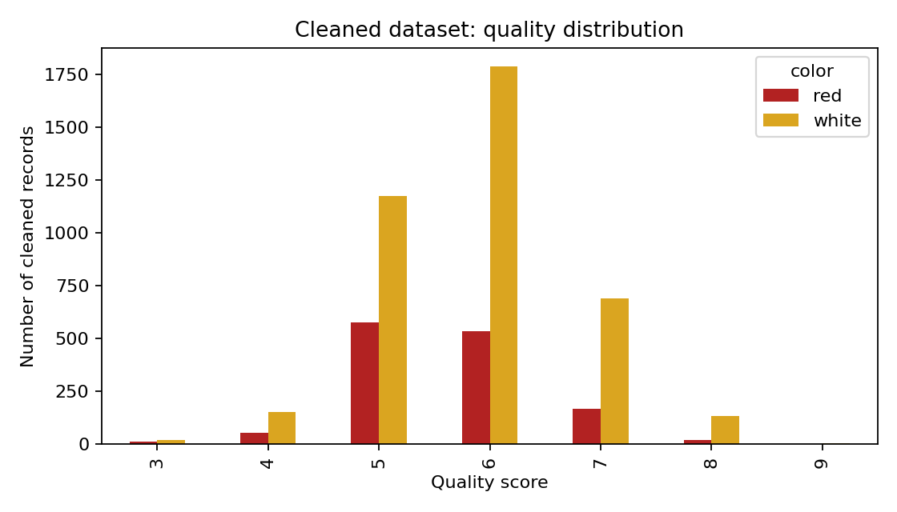
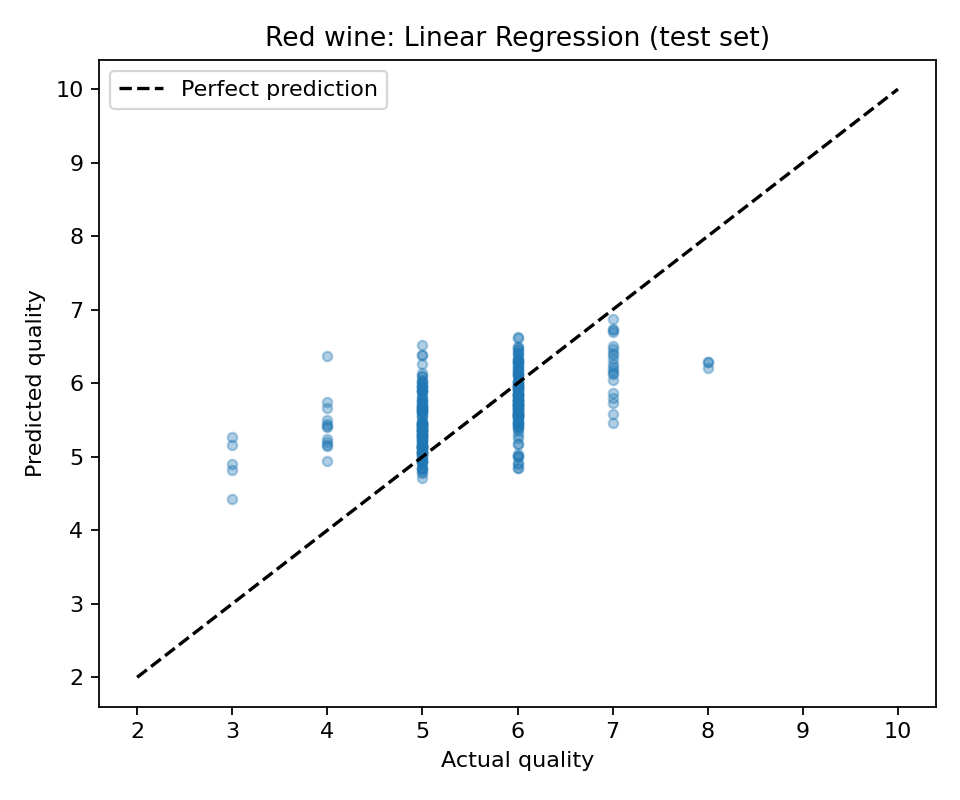
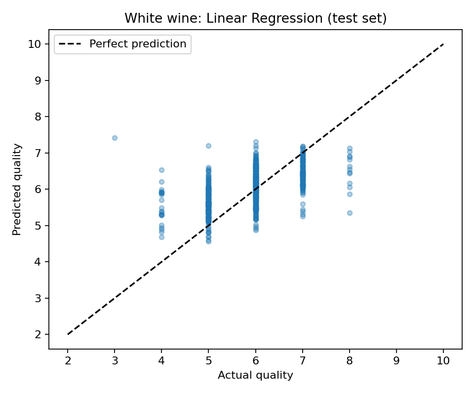
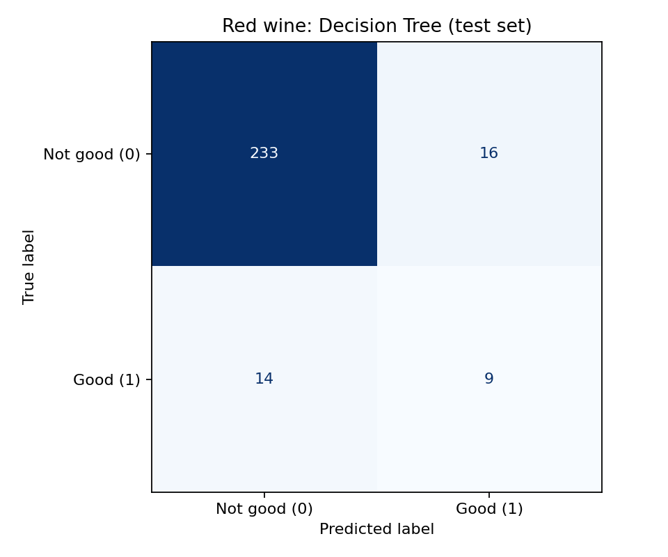
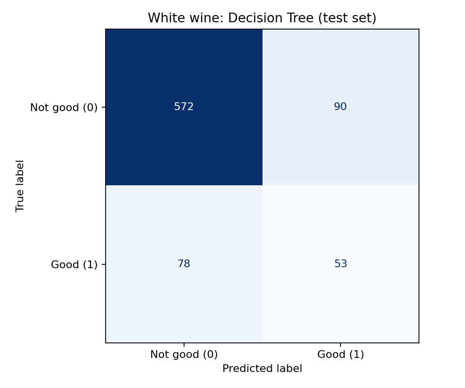

# Part A2: Machine Learning on Wine Quality

## 1. Objectives and approach

This experiment uses the teacher-supplied winequality_with_missing.csv to predict wine quality in two ways. Regression predicts the numerical quality score. Classification predicts whether a wine is good (quality >= 7, label 1) or not good (quality < 7, label 0). Red and white wines are processed separately after cleaning, and each colour has its own regression and classification model.

The methods follow the course material: multiple linear regression from Lecture 5, decision trees and classification evaluation from Lecture 6, and Pandas/NumPy processing from Python Foundations 2. Experiments use the teacher's modified dataset.

## 2. Dataset inspection and cleaning

The input is semicolon-separated. Its chemistry headers contain spaces, whereas the assignment lists underscore-separated names. Header spaces are replaced by underscores consistently; pH retains its original case. This changes names, not observations. The original file is retained. Its SHA-256 fingerprint is recorded in the cleaning summary for reproducibility.

Counts are measured on the raw dataset before deletion. A duplicate means an extra identical complete record, keeping the first occurrence; it does not mean every row belonging to a repeated group. Missing values are counted both as individual cells and as affected rows.

| Cleaning measurement | Count |
| --- | ---: |
| Original records | 6697 |
| Duplicate extra records removed | 1177 |
| Missing cells in original data | 407 |
| Original rows containing missing values | 200 |
| Records after removing duplicates | 5520 |
| Missing-value rows removed after deduplication | 200 |
| Final clean records | 5320 |

Missing values by column are:

| Column | Missing cells |
| --- | ---: |
| fixed_acidity | 34 |
| volatile_acidity | 50 |
| citric_acid | 28 |
| residual_sugar | 44 |
| chlorides | 35 |
| free_sulfur_dioxide | 40 |
| total_sulfur_dioxide | 31 |
| density | 41 |
| pH | 40 |
| sulphates | 27 |
| alcohol | 37 |
| quality | 0 |
| color | 0 |

Cleaning first removes duplicate records with the first occurrence retained, then removes rows containing any missing value. No imputation is used. Surviving records retain their input order. Source-row identifiers support auditing but are excluded from model inputs.

## 3. Ordered training and testing split

After cleaning, records are separated by colour. For each colour, the boundary is floor(0.8 x number of clean records): the first portion is training data and all remaining rows are testing data. There is no shuffle, random split or stratification. This follows the assignment even though ordered subsets may have different class distributions.

| Colour | Clean rows | Training | Testing | Train good | Test good |
| --- | ---: | ---: | ---: | ---: | ---: |
| Red | 1359 | 1087 | 272 | 161 | 23 |
| White | 3961 | 3168 | 793 | 694 | 131 |

The same 11 chemistry features are used for both tasks:

fixed_acidity, volatile_acidity, citric_acid, residual_sugar, chlorides, free_sulfur_dioxide, total_sulfur_dioxide, density, pH, sulphates, alcohol.

The regression target is quality. The binary target is_good is derived from quality solely as a label. Neither quality nor is_good is included in the feature matrix. Colour is constant within each separate experiment, so it is also excluded, along with source_row. Thus the classifier cannot read the score that defines its answer.

## 4. Model choices and training

Multiple linear regression is a clear, interpretable starting point. It estimates a quality score from a weighted sum of the chemistry variables and an intercept. Lecture 5 introduces this extension of single-feature regression. A linear model may miss nonlinear relationships, so its suitability is assessed through held-out errors rather than assumed.

The decision-tree classifier follows Lecture 6. It recursively splits feature ranges to separate the two labels and can express nonlinear decision rules. To limit model complexity, the fixed settings are max_depth=5, min_samples_leaf=5 and random_state=42. The same settings are used for both colours; they are not selected or revised using test performance. These are conservative starting settings, not claimed optimal hyperparameters.

Each model is fitted using only its colour's training features and labels. Test labels are used only for final evaluation. No test-driven model selection, resampling or feature selection is performed. Four fitted models are saved. Keeping one regression algorithm and one classification algorithm makes the experiment consistent with the task and allows the colour-specific findings to be explained.

## 5. Regression evaluation

MAE is the mean absolute prediction error, expressed in quality-score points. MSE is the mean squared error and penalizes larger errors more strongly. R-squared measures performance relative to predicting the test-set mean: 1 is a perfect fit, 0 is that mean reference, and negative values are possible.

For an additional practical comparison, the mean-baseline predictor always outputs the corresponding training-set mean quality. It uses no test-set statistics. Reported regression predictions remain continuous: they are not rounded or clipped before computing metrics.

| Colour | MAE | MSE | R-squared | Training-mean baseline MAE | Baseline MSE |
| --- | ---: | ---: | ---: | ---: | ---: |
| Red | 0.526939 | 0.484720 | 0.266576 | 0.672155 | 0.674664 |
| White | 0.524701 | 0.456466 | 0.214626 | 0.565810 | 0.581219 |

The positive R-squared values indicate some predictive information, but values around 0.27 and 0.21 show that substantial variation remains unexplained. Typical absolute errors are approximately half a score point. The mean-baseline errors help assess whether the fitted relationships improve on a simple prediction rule; these observed results do not establish reliability on a different wine population.

Complete coefficients are exported to results/linear_coefficients.csv. Coefficients describe the fitted linear association while holding other inputs fixed. Their raw magnitudes are not directly comparable feature-importance scores because the variables have different units and may be correlated. They also do not demonstrate causal effects.

## 6. Classification evaluation

Good wine is the positive class. Accuracy measures overall correctness; precision is TP/(TP+FP); recall is TP/(TP+FN); and F1 is the harmonic mean of precision and recall. Confusion matrices below have actual labels as rows and predicted labels as columns, in the order [0, 1].

| Colour | Accuracy | Precision | Recall | F1 | Always-not-good accuracy |
| --- | ---: | ---: | ---: | ---: | ---: |
| Red | 0.889706 | 0.360000 | 0.391304 | 0.375000 | 0.915441 |
| White | 0.788146 | 0.370629 | 0.404580 | 0.386861 | 0.834805 |

**Red wine**

| Actual / predicted | Not good (0) | Good (1) |
| --- | ---: | ---: |
| Not good (0) | 233 (TN) | 16 (FP) |
| Good (1) | 14 (FN) | 9 (TP) |

**White wine**

| Actual / predicted | Not good (0) | Good (1) |
| --- | ---: | ---: |
| Not good (0) | 572 (TN) | 90 (FP) |
| Good (1) | 78 (FN) | 53 (TP) |

For red wine, the classifier finds 9 of 23 good wines (recall 39.13%), misses 14, and labels 16 not-good wines as good. Its accuracy is 2.57 percentage points below the always-not-good reference. Only 8.46% of this test set is good, so accuracy alone gives an incomplete assessment.

For white wine, the classifier finds 53 of 131 good wines (recall 40.46%), misses 78, and labels 90 not-good wines as good. Its accuracy is 4.67 percentage points below the always-not-good reference. Only 16.52% of this test set is good, so accuracy alone gives an incomplete assessment.

The majority reference has zero good-wine recall. The fitted trees identify some good wines, but introduce false positives and still miss many positives. Their modest F1 scores do not support a strong-classifier claim. A use case prioritizing finding good wines would need to consider recall and the cost of incorrect recommendations, rather than choosing by accuracy alone.

## 7. Limitations and reproducibility

Removing incomplete rows follows the task but can change the represented population. The ordered split can expose distribution differences, especially in the proportion of good wines. Quality is a discrete rating with limited range, while linear regression provides continuous estimates. Fixed tree depth and leaf size reduce complexity but do not guarantee generalization. Improving either model would require training-only validation or additional data; the final test set should remain reserved for evaluation.

Saved outputs include the four ordered train/test CSV files, four fitted models, model metadata, cleaning and split summaries, metrics, predictions, coefficients and plots. The model metadata records the feature order and package versions. The experiment versions are: python 3.12.14; pandas 2.2.3; numpy 2.3.5; scikit-learn 1.8.0; matplotlib 3.10.8; joblib 1.5.3; scipy 1.17.0.

The report is generated from the current result files, and its figures show the same run. CSV handling, model persistence with joblib, plotting and Word-report generation are supporting implementation details; they do not introduce another learning algorithm. Saved model files should be used with the recorded compatible library versions.

## References

1. ITP4524_Assignment_2627 v2 .docx, Section A2: tasks, cleaning, ordered split and required metrics.
2. Teacher-supplied winequality_with_missing.csv: experiment input. Original dataset source identified by the assignment: UCI Wine Quality, https://archive.ics.uci.edu/dataset/186/wine+quality.
3. ITP4524_Lecture_05_ML_Regression (3).pptx: multiple regression and MAE, MSE and R-squared evaluation.
4. ITP4524_Lecture_06_ML_Classification (3).pptx: decision trees and classification metrics.
5. Python Foundations 2 - Flow Control, Structured Data Types and NumPyPandas (3).pptx: arrays and tabular data processing.
